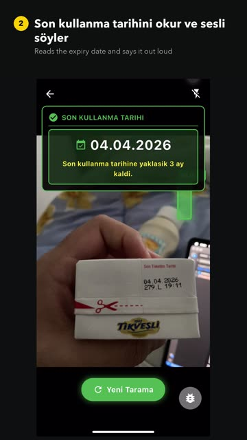

# MarketGöz

AI-powered shopping assistant for visually impaired users in Turkey. Provides barcode scanning, product identification, and expiry date detection with Turkish voice feedback.

## Showcase

[](showcase.mp4)

▶️ [Watch the showcase video (67 s, sound on)](showcase.mp4): mode selection, expiry-date reading, barcode lookup, barcode + date matching, object detection with an expired-product warning, and saving to the product database, all with Turkish voice feedback.

## How it works

The app opens straight into a **guided scan**. The user holds a product in front of the rear camera and the app talks them through it:

1. **Barcode:** ML Kit reads the barcode and the product name is looked up (local catalogue first, then Open Food Facts; works offline without the name).
2. **Guidance:** a state machine turns each OCR frame into spoken prompts ("move it left", "closer", "turn the item") and Geiger-counter style haptics that pulse faster as the expiry date gets closer to readable.
3. **Expiry date:** once SKT/TETT is read with confidence, the app announces the date and how many days remain, in Turkish.

Details:
- Automatic zoom and torch for small printed dates
- Works with TalkBack/VoiceOver (screen reader announcements instead of TTS when active)
- High-contrast UI with large touch targets
- Pure-Dart guidance engine with replay tests from recorded OCR frames (`flutter test`)

## Requirements

- Flutter 3.35.1 (pinned with FVM, see `.fvmrc`)
- iOS 12.0+ / Android 21+
- Camera permission

## Getting Started

1. Install dependencies:
```bash
flutter pub get
```

2. Configure Firebase:
   - Create a Firebase project
   - Add iOS and Android apps
   - Download and add configuration files
   - Run: `flutterfire configure`

3. Run the app (the Gemini key is optional and only read from a build define, never stored in the repo):
```bash
flutter run --dart-define=GEMINI_API_KEY=your_key
```

4. Run the tests:
```bash
flutter test
```

## Project Structure

```
lib/
├── main.dart
├── app/
├── core/
│   ├── constants/
│   ├── expiry/        # OCR frame model, date reader, guidance engine
│   ├── models/
│   ├── services/
│   └── utils/
├── features/
│   └── guided_scan/   # camera controller, zoom policy, haptics, speech
└── shared/
    └── widgets/
```

## Team

**MekaGöz** - İSTEFEST
- Onur Sabri Yıldız
- Tuğba Asude Nacar

Mechatronics Engineering
